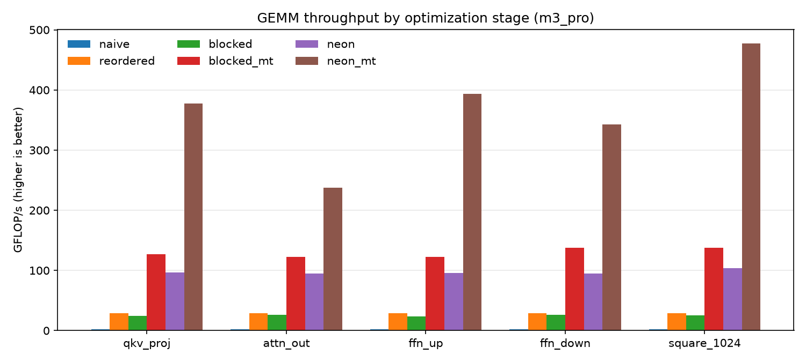

# Neural Network Operator Optimization

I profiled a small Transformer encoder in ONNX Runtime and found that matrix
multiplication (GEMM) takes about 85% of the kernel time. So I wrote a GEMM in
C++ from scratch, in five stages, and measured each one on the exact shapes the
model runs.

The final version is a packed GEMM in the style of BLIS with a hand-written
ARM NEON micro-kernel. On one core of my M3 Pro it gets to 95% of ONNX
Runtime's own GEMM, and on all 11 cores it's 159x faster than the naive loop.
There's also an AVX2 micro-kernel for x86, which CI builds and tests.



## Results

MacBook Pro, M3 Pro (5 performance + 6 efficiency cores), Apple clang 17,
`-O3`. All numbers are from one session, medians, checked against a float64
reference. Raw data is in [`results/m3_pro.csv`](results/m3_pro.csv).

Time for all the GEMMs in one forward pass (1.61 GFLOP):

| Kernel | Threads | Time | GFLOP/s | vs naive |
|---|---:|---:|---:|---:|
| ONNX Runtime (MLAS) | 1 | 15.9 ms | 101 | |
| 1. Naive triple loop | 1 | 727.0 ms | 2.2 | 1x |
| 2. Loop reordering (i, k, j) | 1 | 55.4 ms | 29.1 | 13x |
| 3. Cache blocking | 1 | 64.8 ms | 24.9 | 11x |
| 4. Blocking + threads | 11 | 12.5 ms | 128 | 58x |
| 5. Packed NEON micro-kernel | 1 | 16.8 ms | 95.8 | 43x |
| 5. Packed NEON micro-kernel | 11 | 4.6 ms | 353 | 159x |

NumPy on this Mac uses Apple's Accelerate, which does these shapes at around
1,500 GFLOP/s. That's far beyond what the CPU cores can do, so it's running on
Apple's matrix coprocessor. ONNX Runtime's MLAS runs on the same cores as my
kernel, so that's the comparison I use.

## Things I didn't expect

The naive loop runs at the same ~2.2 GFLOP/s for every shape. It isn't waiting
on memory, it's waiting on itself: every add into the running sum has to wait
for the previous one.

Reordering the loops gives 13x but then gets stuck at ~29 GFLOP/s for every
shape. Each vector FMA also has to load B, load C and store C, which caps it at
about one FMA per cycle. Keeping a tile of C in registers (stage 5) is what got
past that.

Cache blocking made things about 15% slower on my Mac. The biggest B in the
model is 4 MB and the M3 Pro's L2 is 16 MB, so B was already in cache and the
extra loops were pure overhead. On an x86 cloud VM with 2 MB of L2 per core,
the same code was 1.3x to 1.4x faster.

The efficiency cores help the simple kernel but not the fast one. For the
blocked kernel, 11 threads beat 5 (12.5 vs 15.7 ms). For the NEON kernel they
barely do (4.6 vs 4.7 ms), and on the smallest shape 5 threads win. The NEON
calls are so short now (under 0.3 ms) that starting threads and having each one
pack its own copy of A starts to matter.

## How it works

Each stage is one file in `src/` with a comment explaining the change.

1. `gemm_naive.cpp`: the textbook i, j, k loop.
2. `gemm_reordered.cpp`: i, k, j order, so the compiler can vectorize the inner loop.
3. `gemm_blocked.cpp`: 64 x 256 x 256 blocks so a piece of B stays in cache.
4. `gemm_blocked_mt.cpp`: rows of C split across threads (no locks needed).
5. `gemm_simd.cpp`: packs A and B into panels and calls a micro-kernel that
   keeps a tile of C in registers. The NEON kernel (`microkernel_neon.h`) uses
   an 8 x 12 tile, 24 of the 32 NEON registers. The AVX2 one
   (`microkernel_avx2.h`) uses 6 x 16. Which one gets built depends on the CPU.

I checked the assembly to make sure the inner loop is just FMAs with nothing
spilled to the stack. My first NEON version kept the accumulators in an array
and GCC spilled all 24 of them every iteration.

## Build and run

Needs CMake 3.16+ and a C++17 compiler, on Apple Silicon or x86-64 with AVX2.

```bash
cmake -B build && cmake --build build -j
ctest --test-dir build --output-on-failure
./build/bench --csv results/my_machine.csv     # GEMM_THREADS=N sets the thread count
```

Profiling and comparisons need `pip install -r requirements.txt`, then
`python profile_ort.py 1`, `python bench/compare_blas.py 1` and
`python bench/plot_results.py results/my_machine.csv`.

The tests run every kernel on 15 shapes, including ones that don't divide
evenly into tiles or blocks, with C pre-filled with garbage. CI runs them on
macOS (NEON) and Linux (AVX2) with sanitizers on and off.

## Next

- A persistent thread pool and a shared packed A, for better scaling on small shapes
- Fusing bias and GELU into the micro-kernel
- Plugging the kernel into ONNX Runtime as a custom op

## References

- MIT 6.172 Performance Engineering of Software Systems, Fall 2018, Lecture 1
  (Leiserson, Shun): https://ocw.mit.edu/courses/6-172-performance-engineering-of-software-systems-fall-2018/
- Goto and van de Geijn, "Anatomy of High-Performance Matrix Multiplication"
  (2008), and BLIS: https://github.com/flame/blis